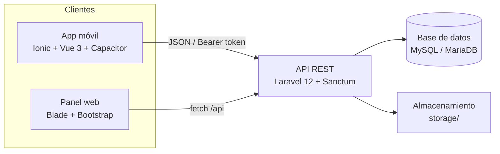
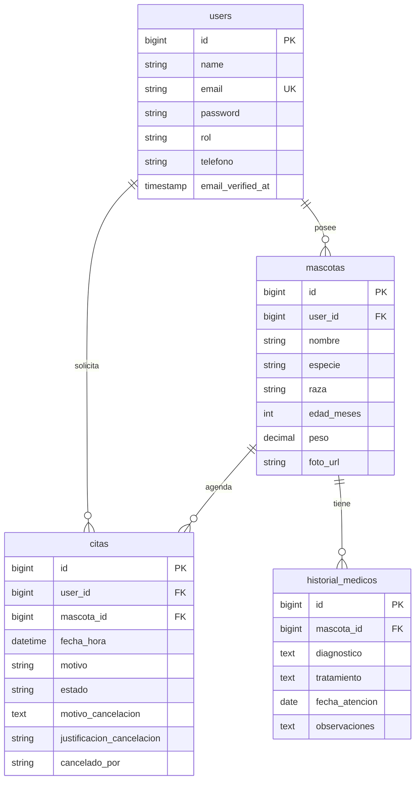

# 🐾 VetCare — Sistema de Gestión Veterinaria

[](https://laravel.com)
[](https://www.php.net)
[](https://vuejs.org)
[](https://ionicframework.com)
[](https://capacitorjs.com)
[](https://www.mysql.com)
[](#estado-del-proyecto)

> **VetCare** es un sistema de gestión para una clínica veterinaria. Los clientes pueden registrar sus mascotas, consultar su historial clínico y agendar o cancelar citas desde una aplicación móvil híbrida. El personal administrativo y veterinario gestiona citas, diagnósticos y usuarios desde un panel web.

Proyecto desarrollado como parte de un proyecto universitario de desarrollo de software.

---

## Tabla de contenidos

- [Descripción](#descripción)
- [Características](#características)
- [Arquitectura](#arquitectura)
- [Tecnologías](#tecnologías)
- [Estructura del repositorio](#estructura-del-repositorio)
- [Modelo de datos](#modelo-de-datos)
- [Requisitos previos](#requisitos-previos)
- [Instalación y ejecución](#instalación-y-ejecución)
- [Variables de entorno](#variables-de-entorno)
- [Roles y permisos](#roles-y-permisos)
- [API REST](#api-rest)
- [Pruebas](#pruebas)
- [Solución de problemas](#solución-de-problemas)
- [Roadmap](#roadmap)
- [Contribuciones](#contribuciones)
- [Autores](#autores)
- [Licencia](#licencia)
- [Agradecimientos](#agradecimientos)

---

## Descripción

VetCare centraliza la operación básica de una veterinaria en tres componentes:

1. **API REST (Laravel + Sanctum):** autenticación, usuarios, mascotas, citas e historiales médicos.
2. **Aplicación móvil (Ionic + Vue 3 + Capacitor):** experiencia del cliente para gestionar sus mascotas y citas.
3. **Panel administrativo web (Blade + Bootstrap):** dashboard para el personal de la veterinaria.

### Estado del proyecto

El proyecto es **funcional en entorno local** y se encuentra en etapa académica. Incluye los flujos principales de autenticación, gestión de mascotas, agendamiento y cancelación de citas, historial clínico y administración de usuarios.

> **Nota:** la carpeta `vet-web/` mencionada en la guía de instalación original **no existe** en este repositorio. El panel administrativo se sirve directamente desde Laravel con vistas Blade, por lo que no requiere un proyecto frontend adicional.

---

## Características

### Aplicación móvil — Clientes

- Registro e inicio de sesión con token de Laravel Sanctum.
- Sesión persistida en el dispositivo mediante `localStorage`.
- Listado de mascotas del usuario autenticado.
- Registro de mascotas con nombre, especie, raza, edad y peso.
- Consulta del historial clínico por mascota.
- Listado de citas propias.
- Agendamiento de citas con calendario y selección de horarios disponibles.
- Consulta de disponibilidad por fecha.
- Cancelación de citas con justificación obligatoria.
- Visualización del motivo y la autoría de la cancelación (cliente o administración).
- Perfil del usuario y cierre de sesión.

### Panel administrativo web — Administradores y veterinarios

- Inicio de sesión mediante la API.
- Dashboard con citas solicitadas desde la app móvil.
- Cambio de estado de las citas: pendiente, completada o cancelada.
- Visualización de la trazabilidad de cancelaciones.
- Registro de diagnósticos, tratamientos y vacunas aplicadas.
- Gestión de usuarios y roles (crear, editar, eliminar).
- Protección del usuario administrador principal.

### API REST

- Autenticación con tokens Bearer de Sanctum.
- CRUD de usuarios con roles `admin`, `veterinario` y `cliente`.
- Gestión de mascotas por usuario.
- Gestión de citas con disponibilidad horaria.
- Historial médico por mascota.
- Soporte de reagendamiento y cancelación a nivel de API.

---

## Arquitectura



La aplicación móvil y el panel web consumen la misma API. El backend concentra la lógica de negocio, la autenticación y el acceso a datos.

---

## Tecnologías

| Capa | Tecnologías |
|---|---|
| **Backend** | PHP 8.2+, Laravel 12, Laravel Sanctum 4, Eloquent ORM, PHPUnit |
| **Base de datos** | MySQL 8+ / MariaDB 10.4+ |
| **App móvil** | Ionic 9, Vue 3, TypeScript, Vite 8, Capacitor 8, Axios, Flatpickr |
| **Panel web** | Laravel Blade, Bootstrap 5, Font Awesome, JavaScript |
| **Pruebas** | PHPUnit, Vitest, Cypress, ESLint |
| **Herramientas** | Composer, npm, Git, Vite |

---

## Estructura del repositorio

```text
Veterinaria/
├── vet-backend/                  # API REST y panel administrativo (Laravel)
│   ├── app/
│   │   ├── Http/
│   │   │   ├── Controllers/      # Auth, usuarios, mascotas, citas e historiales
│   │   │   └── Middleware/       # AdminMiddleware
│   │   └── Models/               # User, Mascota, Cita, HistorialMedico
│   ├── database/
│   │   ├── factories/
│   │   ├── migrations/           # Esquema de la base de datos
│   │   └── seeders/              # Datos iniciales
│   ├── resources/views/
│   │   ├── admin/                # Dashboard y gestión de usuarios
│   │   └── login.blade.php       # Login del panel web
│   ├── routes/
│   │   ├── api.php               # Endpoints REST
│   │   └── web.php               # Rutas del panel web
│   ├── tests/
│   ├── .env.example
│   └── composer.json
├── vet-mobile/                   # Aplicación móvil (Ionic + Vue)
│   ├── src/
│   │   ├── router/
│   │   ├── services/api.ts       # Cliente HTTP y token
│   │   ├── theme/
│   │   └── views/                # Login, mascotas, citas y perfil
│   ├── tests/
│   ├── capacitor.config.ts
│   ├── ionic.config.json
│   └── package.json
├── vet_db.sql                    # Dump de base de datos con datos de ejemplo
└── Guía de Instalación           # Guía rápida original
```

---

## Modelo de datos



### Tablas principales

| Tabla | Propósito |
|---|---|
| `users` | Usuarios del sistema con rol, correo y teléfono. |
| `mascotas` | Mascotas registradas por cada cliente. |
| `citas` | Citas veterinarias, estado y trazabilidad de cancelación. |
| `historial_medicos` | Diagnósticos, tratamientos y observaciones por mascota. |
| `personal_access_tokens` | Tokens de autenticación de Sanctum. |

Los estados de una cita se manejan como `Pendiente`, `Completada` y `Cancelada` en la interfaz. La migración define el campo `estado` como `enum` con valores en minúsculas (`pendiente`, `confirmada`, `atendida`, `cancelada`).

---

## Requisitos previos

| Herramienta | Versión recomendada |
|---|---|
| PHP | 8.2 o superior |
| Composer | 2.x |
| MySQL / MariaDB | MySQL 8+ / MariaDB 10.4+ |
| Node.js | 22 LTS (mínimo 20.19+) |
| npm | 10+ |
| Ionic CLI | Opcional, para `ionic serve` |
| Android Studio / Xcode | Opcional, para compilar la app móvil |

Extensiones de PHP necesarias: `pdo_mysql`, `mbstring`, `openssl`, `ctype`, `json`, `xml`, `tokenizer` y `fileinfo`.

---

## Instalación y ejecución

### 1. Clonar el repositorio

```bash
git clone https://github.com/Gerardo-Colocho/Veterinaria.git
cd Veterinaria
```

### 2. Crear la base de datos

```bash
mysql -u root -p -e "CREATE DATABASE vet_db CHARACTER SET utf8mb4 COLLATE utf8mb4_unicode_ci;"
```

### 3. Configurar el backend

```bash
cd vet-backend
composer install
cp .env.example .env
```

Edita `.env` con tus credenciales de MySQL:

```env
DB_CONNECTION=mysql
DB_HOST=127.0.0.1
DB_PORT=3306
DB_DATABASE=vet_db
DB_USERNAME=root
DB_PASSWORD=
```

Genera la clave de la aplicación, ejecuta las migraciones y levanta el servidor:

```bash
php artisan key:generate
php artisan migrate --seed
php artisan serve
```

La API quedará disponible en `http://127.0.0.1:8000/api` y el chequeo de salud en `http://127.0.0.1:8000/up`.

El seeder crea un usuario de prueba:

| Correo | Contraseña | Rol inicial |
|---|---|---|
| `test@example.com` | `password` | `cliente` |

Para acceder al panel administrativo, promueve ese usuario a administrador:

```bash
php artisan tinker --execute="\App\Models\User::where('email', 'test@example.com')->update(['rol' => 'admin']);"
```

> También puedes crear tu propio usuario desde `/api/register` y luego cambiar su rol en la base de datos.

### 4. Acceder al panel web

El panel administrativo se sirve desde el mismo Laravel. No hay que instalar otro proyecto:

```text
http://127.0.0.1:8000/login
```

Desde ahí podrás iniciar sesión con un usuario `admin` o `veterinario`.

### 5. Configurar la aplicación móvil

En otra terminal:

```bash
cd vet-mobile
npm install
npm run dev
```

La app estará disponible en `http://localhost:5173`.

También puedes usar la CLI de Ionic:

```bash
npm install -g @ionic/cli
ionic serve
```

#### URL de la API en la app móvil

La URL está definida en:

- `vet-mobile/src/services/api.ts` → `http://127.0.0.1:8000/api`
- `vet-mobile/src/views/Tab1Page.vue` → `http://localhost:8000/api`

Si usas un emulador de Android, cambia `127.0.0.1` por `10.0.2.2`. Si usas un dispositivo físico, usa la IP LAN de tu computadora, por ejemplo `http://192.168.1.50:8000/api`.

> **Mejora pendiente:** centralizar esta URL en una variable de entorno de Vite (`VITE_API_URL`) y reutilizarla en todos los componentes.

### 6. Compilar para Android o iOS (opcional)

```bash
cd vet-mobile
npm run build
npx cap add android      # Solo la primera vez
npx cap sync
npx cap open android
```

Para iOS necesitas macOS y Xcode:

```bash
npx cap add ios
npx cap sync
npx cap open ios
```

> El `appId` actual de Capacitor es `io.ionic.starter`. Cámbialo en `capacitor.config.ts` antes de generar una build de producción.

### 7. Importar el dump SQL (opcional)

El repositorio incluye `vet_db.sql` con datos de ejemplo. Si prefieres usarlo en lugar de las migraciones:

```bash
mysql -u root -p vet_db < vet_db.sql
cd vet-backend
php artisan migrate
```

El dump es de octubre de 2026 y no incluye las últimas migraciones de trazabilidad de cancelaciones, por eso se ejecuta `php artisan migrate` después de importarlo.

---

## Variables de entorno

El archivo `.env.example` incluido contiene los valores base. Nunca subas tu `.env` real al repositorio.

| Variable | Ejemplo | Descripción |
|---|---|---|
| `APP_NAME` | `VetCare` | Nombre de la aplicación. |
| `APP_ENV` | `local` | Entorno de ejecución. |
| `APP_KEY` | *(generada)* | Clave de cifrado de Laravel. Se genera con `php artisan key:generate`. |
| `APP_DEBUG` | `true` | Modo depuración. Usa `false` en producción. |
| `APP_URL` | `http://localhost:8000` | URL base del backend. |
| `DB_CONNECTION` | `mysql` | Motor de base de datos. |
| `DB_HOST` | `127.0.0.1` | Host de la base de datos. |
| `DB_PORT` | `3306` | Puerto de MySQL/MariaDB. |
| `DB_DATABASE` | `vet_db` | Nombre de la base de datos. |
| `DB_USERNAME` | `root` | Usuario de la base de datos. |
| `DB_PASSWORD` | *(vacío)* | Contraseña de la base de datos. |
| `SESSION_DRIVER` | `database` | Driver de sesiones. |
| `CACHE_STORE` | `database` | Almacenamiento de caché. |
| `QUEUE_CONNECTION` | `database` | Driver de colas. |

---

## Roles y permisos

| Rol | Acceso principal | Alcance |
|---|---|---|
| `admin` | Panel web y API | Gestión completa de citas, historiales y usuarios. El administrador principal está protegido contra edición y eliminación. |
| `veterinario` | Panel web y API | Gestión de citas e historiales médicos. |
| `cliente` | App móvil y API | Gestión de sus propias mascotas, citas e historial. |

### Nota de seguridad

El panel web valida la existencia del token en el navegador, pero las rutas `/admin` de `routes/web.php` **no están protegidas actualmente** por el middleware `admin`. Para un despliegue real se recomienda:

- Aplicar `->middleware('admin')` a las rutas del panel.
- Usar sesiones/cookies de Sanctum o una autenticación web adecuada.
- Restringir `allowed_origins` en `config/cors.php` (actualmente es `*`).
- Validar la propiedad de las citas y mascotas en todos los endpoints.
- Usar HTTPS y credenciales seguras.

---

## API REST

**URL base:** `http://127.0.0.1:8000/api`

Las rutas protegidas requieren el token devuelto por el login:

```http
Authorization: Bearer <token>
Accept: application/json
```

### Endpoints

| Método | Endpoint | Descripción | Auth |
|---|---|---|---|
| `POST` | `/api/register` | Registrar un usuario. | No |
| `POST` | `/api/login` | Iniciar sesión y obtener token. | No |
| `POST` | `/api/logout` | Cerrar la sesión actual. | Sí |
| `GET` | `/api/users` | Listar usuarios. | Sí |
| `POST` | `/api/users` | Crear usuario con rol. | Sí |
| `PUT/PATCH` | `/api/users/{id}` | Actualizar usuario (excepto admin). | Sí |
| `DELETE` | `/api/users/{id}` | Eliminar usuario (excepto admin). | Sí |
| `GET` | `/api/mascotas` | Listar mascotas del usuario autenticado. | Sí |
| `POST` | `/api/mascotas` | Registrar una mascota. | Sí |
| `DELETE` | `/api/mascotas/{id}` | Eliminar una mascota propia. | Sí |
| `GET` | `/api/mascotas/{id}/historial` | Historial clínico de una mascota. | Sí |
| `GET` | `/api/citas` | Listar citas (todas si es admin; propias si es cliente). | Sí |
| `POST` | `/api/citas` | Agendar una cita. | Sí |
| `GET` | `/api/citas/disponibilidad?fecha=YYYY-MM-DD` | Consultar horarios disponibles. | Sí |
| `PUT/PATCH` | `/api/citas/{id}` | Actualizar, reagendar o cancelar una cita. | Sí |
| `DELETE` | `/api/citas/{id}` | Eliminar una cita. | Sí |
| `GET` | `/api/historiales` | Listar historiales médicos. | Sí |
| `POST` | `/api/historiales` | Registrar un historial médico. | Sí |
| `GET` | `/api/historiales/{mascota_id}` | Historial por mascota (implementación actual). | Sí |

> Las rutas `show` de mascotas y las rutas `update` de mascotas/historiales están registradas por `apiResource`, pero aún no tienen método implementado en sus controladores.

### Ejemplos con cURL

**Iniciar sesión:**

```bash
curl -X POST http://127.0.0.1:8000/api/login \
  -H "Content-Type: application/json" \
  -H "Accept: application/json" \
  -d '{"email":"test@example.com","password":"password"}'
```

**Listar mascotas:**

```bash
curl http://127.0.0.1:8000/api/mascotas \
  -H "Accept: application/json" \
  -H "Authorization: Bearer TU_TOKEN"
```

**Consultar disponibilidad:**

```bash
curl "http://127.0.0.1:8000/api/citas/disponibilidad?fecha=2026-12-01" \
  -H "Accept: application/json" \
  -H "Authorization: Bearer TU_TOKEN"
```

**Agendar una cita:**

```bash
curl -X POST http://127.0.0.1:8000/api/citas \
  -H "Content-Type: application/json" \
  -H "Accept: application/json" \
  -H "Authorization: Bearer TU_TOKEN" \
  -d '{
    "mascota_id": 1,
    "fecha_hora": "2026-12-01 09:00:00",
    "motivo": "Chequeo general"
  }'
```

### Horarios disponibles

La API ofrece los siguientes bloques:

```text
08:00, 09:00, 10:00, 11:00, 13:00, 14:00, 15:00, 16:00
```

Se excluyen las citas que no estén canceladas para la fecha consultada.

---

## Pruebas

### Backend

```bash
cd vet-backend
php artisan test
```

### App móvil

```bash
cd vet-mobile
npm run test:unit
npm run test:e2e
npm run lint
```

> Las pruebas incluidas actualmente son de ejemplo. Se recomienda ampliarlas para cubrir autenticación, permisos, agendamiento, cancelación e historiales.

---

## Solución de problemas

| Problema | Posible solución |
|---|---|
| `php: command not found` | Instala PHP 8.2+ y agrega el binario al `PATH`. |
| `Unknown database 'vet_db'` | Crea la base de datos con el comando de la sección de instalación. |
| `SQLSTATE[HY000] [2002] Connection refused` | Verifica que MySQL/MariaDB esté iniciado y que el host/puerto sean correctos. |
| `No application encryption key has been specified` | Ejecuta `php artisan key:generate`. |
| `401 Unauthenticated` | Inicia sesión nuevamente y envía el token en el header `Authorization`. |
| `Network Error` o error de CORS en la app | Confirma que Laravel esté corriendo y que la URL de la API sea correcta. |
| La app Android no conecta con la API | Usa `http://10.0.2.2:8000/api` en lugar de `127.0.0.1`. |
| `Vite requires Node.js version...` | Actualiza Node.js a la versión 22 LTS. |
| `Module not found` en la app móvil | Ejecuta `npm install` dentro de `vet-mobile`. |
| Error de permisos en `storage/` o `bootstrap/cache/` | En Linux: `chmod -R ug+rwx storage bootstrap/cache`. |
| El panel web redirige al login | Verifica que exista `vet_token` en `localStorage` y que el usuario tenga rol `admin` o `veterinario`. |

---

## Roadmap

- [x] API REST con autenticación Sanctum.
- [x] App móvil con mascotas, citas e historial.
- [x] Panel administrativo con citas, diagnósticos y usuarios.
- [x] Trazabilidad de cancelaciones por cliente y administrador.
- [ ] Pruebas automatizadas de los flujos principales.
- [ ] Proteger las rutas `/admin` con middleware y sesión.
- [ ] Centralizar la URL de la API en variables de entorno.
- [ ] Completar el CRUD de mascotas e historiales.
- [ ] Notificaciones y recordatorios de citas.
- [ ] Subida de fotos de mascotas.
- [ ] Personalizar `appId` de Capacitor y generar builds.
- [ ] Despliegue y CI/CD.
- [ ] Licencia de uso.

---

## Contribuciones

Este es un proyecto académico. Si deseas proponer una mejora:

1. Haz un fork del repositorio.
2. Crea una rama descriptiva: `feature/nueva-funcionalidad` o `fix/correccion`.
3. Realiza commits siguiendo Conventional Commits, por ejemplo: `feat: agregar recordatorios de citas`.
4. Sube la rama y abre un Pull Request.
5. Describe claramente el cambio y cómo probarlo.

Para cambios grandes, coordina primero con los autores.

---

## Autores

- **Gerardo Colocho** — [@Gerardo-Colocho](https://github.com/Gerardo-Colocho)
- **Mikki** — [@MzhyMike](https://github.com/MzhyMike)

Repositorio: [github.com/Gerardo-Colocho/Veterinaria](https://github.com/Gerardo-Colocho/Veterinaria)

---

## Licencia

Este proyecto se comparte con fines **académicos y educativos**. No se incluye una licencia de código abierto; los derechos pertenecen a sus autores. Si deseas reutilizar el código, contacta primero con ellos.

---

## Agradecimientos

- [Laravel](https://laravel.com) por el framework backend y Sanctum.
- [Ionic](https://ionicframework.com) y [Vue.js](https://vuejs.org) por la base de la aplicación móvil.
- [Capacitor](https://capacitorjs.com) por el puente hacia Android e iOS.
- [Bootstrap](https://getbootstrap.com) y [Font Awesome](https://fontawesome.com) por el panel administrativo.
- [Flatpickr](https://flatpickr.js.org) por el selector de fechas.
